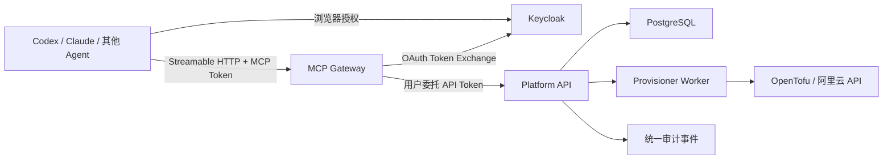

# 平台 MCP Server 设计

- 日期：2026-07-14
- 适用分支：`codex/MCP`
- 状态：设计已完成，待书面复核
- 目标范围：通过远程 MCP Server 向用户 Agent 开放成熟的模板、镜像、综合靶场实例和单实例管理能力

## 1. 背景

平台当前已经具备：

1. 多用户登录和 `admin / user` 角色
2. 模板、镜像、综合靶场实例和单实例的资源归属控制
3. 综合靶场与单实例的创建、销毁和任务执行链路
4. `ProvisionJob` 与 `ProvisionJobStepLog` 形式的异步任务历史
5. Docker Compose 下的 Web、API、Worker、PostgreSQL 与 OpenTofu 运行拓扑

下一步需要让 Codex、Claude 或其他 MCP Client 代表当前登录用户操作平台。MCP 不能成为绕过现有权限和业务状态机的第二套后端，也不能直接持有阿里云密钥、访问数据库或调用 OpenTofu。

本设计采用独立 MCP Gateway。MCP 只负责协议适配、用户委托、工具编排和结果整形，平台 API 继续作为唯一业务入口。

## 2. 设计目标

本次设计目标如下：

1. 提供远程 HTTPS MCP Server，使用 Streamable HTTP 传输
2. Agent 代表当前用户操作平台，不使用共享管理员身份
3. 使用 Keycloak 提供 OAuth 2.1 / OIDC 登录、授权和 Token 生命周期
4. MCP 与平台 API 使用不同 Audience，并通过 Token Exchange 完成用户委托
5. 复用平台现有角色、资源归属和状态机
6. 首期只开放已经成熟或接近成熟的实例管理能力
7. 不开放模板拓扑创建和编辑
8. 对创建、销毁、重试、重启和打包镜像实施显式确认
9. 为所有 MCP 工具调用提供统一审计、幂等和结构化错误
10. 所有构建、启动和验证通过 Docker 容器完成

## 3. 非目标

本轮明确不处理：

1. 通过 Agent 创建或修改模板拓扑
2. 模板克隆、编辑、校验、发布、取消发布、分享和删除
3. 镜像收录、编辑、启停、发布、取消发布和删除
4. 综合靶场内部 ECS 节点的开机、关机、重启、VNC 或打包镜像
5. 用户管理和系统配置 MCP 工具
6. MCP 直接访问 PostgreSQL、阿里云 API 或 OpenTofu
7. 无约束的匿名 OAuth Dynamic Client Registration
8. 把参考 MCP Server 直接改造成生产服务
9. 实现复杂组织、多租户或字段级 ACL
10. 将“综合靶场整体关机”实现为资源暂停；本设计中的整体关机语义是销毁资源

## 4. 方案选择

### 4.1 采用方案

采用独立 MCP Gateway：

- 新增 `apps/mcp`
- MCP 通过内部 HTTPS/HTTP 调用平台 API
- 平台 API 继续执行权限、资源归属、业务状态机、审计和幂等控制
- Worker 继续执行异步创建和销毁任务

### 4.2 不采用的方案

#### MCP 嵌入 API 进程

该方案部署更少，但会把 MCP 生命周期、传输和业务 API 强耦合，也更容易出现工具处理器绕过现有 HTTP 权限边界的问题。

#### MCP 直连数据库和云服务

该方案会复制权限与状态机，绕开业务审计，并让 MCP 持有高权限云凭据，因此禁止采用。

#### Fork 通用 MCP Server

通用或参考 Server 只能作为协议示例，不能替代平台领域模型。生产实现直接使用官方 TypeScript SDK，并在本仓库内实现平台工具。

## 5. 总体架构



### 5.1 信任边界

MCP Gateway：

1. 验证面向 MCP 的 Access Token
2. 解析用户身份、OAuth Client 和 Scopes
3. 注册并执行 MCP 工具
4. 生成 `requestId`、确认请求和幂等键
5. 通过 Token Exchange 获取面向平台 API 的短期委托 Token
6. 调用平台 API 并将响应转换为稳定 MCP 结果

MCP Gateway 不得：

1. 查询或写入平台数据库
2. 持有阿里云 AccessKey
3. 调用 OpenTofu
4. 自行判断资源归属后绕过 API
5. 在日志中记录工具原始输入或敏感输出

平台 API：

1. 将 OIDC Subject 映射为 `PlatformUser`
2. 校验用户状态、角色、Scope 和资源归属
3. 执行业务参数校验与状态机
4. 创建确认记录、审计事件和异步任务
5. 执行幂等控制
6. 返回稳定业务 DTO

Worker：

1. 继续处理 `ProvisionJob`
2. 不接受 MCP 直接调用
3. 在任务完成或失败时补充审计结果事件

### 5.2 SDK 选择

截至 2026-07-14，官方 TypeScript SDK v2 仍处于 beta。生产实现固定使用受支持的 `@modelcontextprotocol/sdk` v1，并锁定经过容器验证的精确版本。

后续升级 v2 必须作为独立兼容性任务处理，不在本轮顺手切换。

## 6. 认证与用户委托

### 6.1 Keycloak 职责

Keycloak 负责：

1. 用户登录与密码
2. MFA 与会话生命周期
3. OAuth Authorization Code + PKCE
4. Access Token 与 Refresh Token
5. MCP Client 注册策略
6. MCP 到平台 API 的 Token Exchange

平台数据库继续负责：

1. `admin / user` 角色
2. `active / disabled` 状态
3. 资源归属
4. 平台业务权限

Keycloak 不作为资源归属和平台业务角色的唯一事实来源。

### 6.2 用户映射

`PlatformUser` 增加稳定身份映射字段：

- `oidcIssuer`
- `oidcSubject`

二者组成唯一身份键。API 根据 `iss + sub` 查找平台用户，并在每次请求时确认用户仍为 `active`。

不能仅依赖 Token 内缓存的角色，因为用户禁用或角色变更需要尽快生效。

### 6.3 Web 登录迁移

Web 与 MCP 最终统一到 Keycloak：

1. Web 使用 OIDC Authorization Code + PKCE
2. MCP Client 使用同一 Keycloak 登录页面
3. 现有本地用户名密码登录仅保留为开发环境兼容路径
4. 生产通过配置关闭本地会话签发
5. 现有密码不能从 hash 中恢复，用户迁移时需要重新设置 Keycloak 密码

### 6.4 Audience 隔离

定义两个独立受保护资源：

- MCP Resource：`aud=mcp`
- Platform API Resource：`aud=platform-api`

流程如下：

1. MCP Client 获取 `aud=mcp` 的用户 Token
2. MCP Gateway 验证 `iss`、`sub`、`aud`、`exp`、签名和 Client 身份
3. MCP Gateway 使用自己的机密客户端身份和 Subject Token 执行 Token Exchange
4. Keycloak 返回 `aud=platform-api` 的短期用户委托 Token
5. 平台 API 验证该 Token，并确认调用客户端是 MCP Gateway

禁止将 `aud=mcp` Token 原样透传给平台 API。

### 6.5 OAuth 发现与客户端注册

MCP 对外提供 OAuth Protected Resource Metadata，并通过 `WWW-Authenticate` 指向对应元数据地址。

首期客户端注册规则：

1. 生产环境预注册明确支持的 MCP Client
2. 严格限制 Redirect URI
3. 不开放任意匿名 Dynamic Client Registration
4. 开发环境如需 DCR，必须通过独立策略和受信主机白名单开启

## 7. 权限模型

最终权限计算为：

`OAuth Scopes ∩ 平台用户权限 ∩ 资源归属规则 ∩ 资源当前状态`

### 7.1 首期 Scopes

- `templates:read`
- `images:read`
- `ranges:read`
- `ranges:create`
- `ranges:destroy`
- `ranges:credentials:read`
- `instances:read`
- `instances:create`
- `instances:destroy`
- `instances:control`
- `instances:credentials:read`
- `jobs:read`

### 7.2 权限执行规则

1. `tools/list` 根据当前 Token Scopes 过滤明显不可用的工具
2. `tools/call` 每次重新鉴权
3. 普通用户只能查询和操作自己的实例、批次和任务
4. 普通用户只能消费平台可见模板和镜像，或使用自己拥有的资源
5. `admin` 可以查看和操作全部资源，但仍受 Scope 和资源状态机约束
6. MCP Gateway 的客户端身份不能提升用户权限

工具隐藏只用于减少 Agent 误选，不能代替服务端鉴权。

## 8. MCP v1 工具范围

### 8.1 模板

#### `range_template_list`

用途：列出当前用户可消费的模板。

主要参数：

- `view`: `mine | platform`
- `limit`
- `cursor`

权限：`templates:read`

#### `range_template_get`

用途：读取模板详情，但不返回可修改拓扑的编辑接口。

主要参数：

- `templateId`

权限：`templates:read` 加模板可见性校验

平台 API 当前缺少独立模板详情路由，实施时新增只读 `GET /admin/scenarios/:id`，并复用 `RangeTemplatesService` 的可读性判断。

### 8.2 综合靶场实例

#### `range_instance_list`

用途：列出当前用户可见的综合靶场实例。

主要参数：

- `view`: `active | history`
- `limit`
- `cursor`

权限：`ranges:read`

#### `range_instance_get`

用途：读取综合靶场整体状态、模板快照、节点摘要、IP 摘要、到期时间和任务状态。

该工具不返回明文账号密码。

权限：`ranges:read` 加 owner/admin 校验

#### `range_instance_get_access`

用途：读取综合靶场中各主机的 IP、账号、密码和 SSH 访问信息。

权限：`ranges:credentials:read` 加 owner/admin 校验

约束：

1. 结果不得写入日志
2. 错误不得回显凭据
3. MCP Gateway 不缓存结果
4. 普通列表和详情不得顺带返回密码

#### `range_instance_launch`

用途：根据现有模板创建并启动整套综合靶场资源。

主要参数：

- `templateId`
- `name`
- `expiresAt`
- `idempotencyKey`
- `confirmationId`

权限：`ranges:create` 加模板可消费校验

结果：立即返回实例 ID、任务 ID 和操作 ID，不等待云资源完成。

#### `range_instance_destroy`

用途：销毁整个综合靶场。

主要参数：

- `rangeInstanceId`
- `idempotencyKey`
- `confirmationId`

权限：`ranges:destroy` 加 owner/admin 校验

语义：该操作执行完整资源销毁，不是暂停或普通关机。

### 8.3 镜像

#### `platform_image_list`

用途：列出当前用户可用于创建单实例的平台镜像和个人可用镜像。

主要参数：

- `view`: `mine | platform`
- `limit`
- `cursor`

权限：`images:read`

该工具只读，不开放镜像收录、修改或发布管理。

### 8.4 单实例

#### `single_instance_list`

用途：按批次和独立实例列出当前用户可见的单实例。

主要参数：

- `view`: `active | history`
- `limit`
- `cursor`

权限：`instances:read`

普通列表不返回明文密码。

#### `single_instance_get`

用途：读取单实例详情，包括状态、规格、镜像、IP、到期时间、任务和批次信息。

权限：`instances:read` 加 owner/admin 校验

平台 API 当前缺少独立单实例详情路由，实施时新增只读 `GET /admin/instances/:id`。

#### `single_instance_get_access`

用途：读取单实例的 IP、账号、密码和 SSH 访问信息。

权限：`instances:credentials:read` 加 owner/admin 校验

敏感信息规则与 `range_instance_get_access` 相同。

#### `single_instance_batch_launch`

用途：使用现有平台镜像批量创建单实例。

主要参数：

- `platformImageAssetId`
- `name`
- `hostName`
- `cpu`
- `memory`
- `systemDiskSize`
- `quantity`
- `expiresAt`
- `remark`
- `password`，可选
- `idempotencyKey`
- `confirmationId`

权限：`instances:create` 加镜像可消费校验

结果：返回批次 ID、子实例 ID、任务 ID 和操作 ID。

#### `single_instance_destroy`

用途：销毁一台单实例。

权限：`instances:destroy` 加 owner/admin 校验

#### `single_instance_batch_destroy`

用途：销毁批次内所有尚未销毁的实例。

权限：`instances:destroy` 加批次 owner/admin 校验

确认记录必须绑定确认时的目标实例 ID 集合。执行时目标集合发生变化则拒绝使用原确认。

#### `single_instance_retry`

用途：重试处于 `create_failed` 或 `destroy_failed` 的单实例任务。

权限：`instances:control` 加 owner/admin 校验

#### `single_instance_reboot`

用途：重启一台运行中的单实例。

权限：`instances:control` 加 owner/admin 校验

#### `single_instance_open_vnc`

用途：返回单实例临时 VNC 访问地址。

权限：`instances:credentials:read` 加 owner/admin 校验

约束：

1. 不需要二次确认
2. 审计只记录访问事件，不记录 VNC URL
3. URL 不缓存、不进入普通工具结果和错误信息

#### `single_instance_pack_image`

用途：将单实例打包为当前用户名下的私有镜像。

权限：`instances:control` 加 owner/admin 校验

结果：返回操作状态和新镜像标识，不返回或记录默认密码。

### 8.5 异步任务

#### `provision_job_get`

用途：查询创建、销毁或重试任务的状态和步骤摘要。

主要参数：

- `jobId`
- `includeSteps`

权限：`jobs:read` 加任务关联实例的 owner/admin 校验

现有平台 API 已提供任务详情和步骤接口，MCP 只做结果整形。

### 8.6 明确不开放的现有路由

即使平台 API 已经存在，首期 MCP 也不注册以下工具：

1. 模板创建、克隆、编辑、发布、取消发布、分享、取消分享和删除
2. 综合靶场草稿保存、草稿应用、模板同步和节点动作
3. 镜像收录、编辑、启停、发布、取消发布和删除
4. 用户管理
5. 系统配置

## 9. 工具输入与输出

### 9.1 输入规则

1. 使用严格 Zod/JSON Schema
2. 拒绝未声明字段
3. ID、数量、规格和时间进行边界校验
4. 时间统一使用带时区的 ISO 8601
5. 不接受调用方传入 `createdBy`、`ownerUserId` 或 `triggeredBy`
6. 身份字段只从委托 Token 推导

### 9.2 输出信封

所有工具返回稳定信封：

```json
{
  "requestId": "req_...",
  "status": "succeeded | accepted | confirmation_required | failed",
  "data": {},
  "operation": {
    "operationId": "op_...",
    "jobId": "job_..."
  },
  "error": {
    "code": "INVALID_STATE",
    "message": "..."
  }
}
```

不适用的字段省略，不返回 `null` 填充整份信封。

### 9.3 敏感输出

以下内容视为敏感：

1. 实例账号和密码
2. SSH 连接信息中的凭据部分
3. VNC URL
4. OAuth Token
5. Keycloak Client Secret
6. 阿里云 AccessKey

敏感输出规则：

1. 仅由专用工具返回
2. MCP Gateway 不缓存
3. 不进入审计参数、结果、异常或协议日志
4. 返回后由 MCP Client 自行按其安全策略处理

## 10. 确认机制

### 10.1 需要确认的操作

以下工具必须显式确认：

- `range_instance_launch`
- `range_instance_destroy`
- `single_instance_batch_launch`
- `single_instance_destroy`
- `single_instance_batch_destroy`
- `single_instance_retry`
- `single_instance_reboot`
- `single_instance_pack_image`

以下工具不需要二次确认：

- 所有列表与详情工具
- `range_instance_get_access`
- `single_instance_get_access`
- `single_instance_open_vnc`
- `provision_job_get`

### 10.2 两阶段流程

1. Agent 首次调用变更工具，但不携带有效 `confirmationId`
2. MCP 请求平台 API 创建确认意图
3. API 返回 `confirmation_required`、影响摘要和短时有效的 `confirmationId`
4. Agent 向用户展示影响摘要
5. 用户确认后，Agent 使用相同参数和 `confirmationId` 再次调用
6. API 校验确认记录并消费该记录
7. API 创建审计事件和业务任务

客户端支持 MCP Elicitation 时，优先使用客户端原生确认界面；不支持时使用上述两次调用流程。

### 10.3 确认记录绑定

确认记录绑定：

1. 用户 ID
2. OAuth Client ID
3. 工具名
4. 参数规范化后的 hash
5. 目标资源及其关键版本快照
6. 过期时间
7. 幂等键

确认记录：

1. 短时有效
2. 只能使用一次
3. 参数变化后失效
4. 资源状态或批次目标集合变化后失效
5. 不保存密码等敏感参数的明文

## 11. 幂等设计

所有变更工具必须提供 `idempotencyKey`。

服务端唯一键至少包含：

- `actorUserId`
- `toolName`
- `idempotencyKey`

规则：

1. 同一键和同一参数重复调用时返回原操作结果
2. 同一键但参数不同返回 `CONFLICT`
3. MCP Gateway 不自动重试变更工具
4. 客户端超时但任务已提交时，返回或恢复原 `operationId/jobId`
5. 查询工具可以进行有限的网络级重试

## 12. 审计设计

### 12.1 当前缺口

当前 `ProvisionJob` 和 `ProvisionJobStepLog` 可以记录综合靶场和单实例创建、销毁、重试等异步任务，但不是完整审计：

1. 缺少统一的 Web/MCP/System 来源字段
2. 缺少 OAuth Client、工具名、请求 ID 和确认信息
3. 单实例重启、VNC 和打包镜像等直接动作没有统一业务审计
4. 凭据读取没有独立访问事件

因此不能仅依赖现有任务表宣称所有 MCP 操作已被审计。

### 12.2 统一历史体验

新增审计事件，但不废弃现有任务历史：

1. `ProvisionJob` 继续作为异步执行事实
2. 审计事件记录谁通过什么入口请求了什么操作
3. 审计事件通过 `jobId` 关联任务
4. 平台历史页面统一展示 Web、MCP 和 System 操作
5. 用户看到同一份操作历史，而不是独立 MCP 日志页面

### 12.3 审计阶段

同一 `operationId` 下允许追加：

- `requested`
- `confirmation_required`
- `confirmed`
- `dispatched`
- `succeeded`
- `failed`

### 12.4 审计字段

至少记录：

- `operationId`
- `requestId`
- `actorUserId`
- `source`: `web | mcp | system`
- `oauthClientId`
- `toolName`
- `phase`
- `targetType`
- `targetId`
- `sanitizedInput`
- `jobId`
- `errorCode`
- `durationMs`
- `createdAt`

审计事件只追加，不允许普通业务路径修改或删除。

### 12.5 敏感信息审计

`range_instance_get_access`、`single_instance_get_access` 和 `single_instance_open_vnc` 仍然记录访问事件，但只记录：

1. 用户
2. 来源
3. 工具
4. 目标实例
5. 成功或失败
6. 时间和请求 ID

不得记录：

1. 账号
2. 密码
3. SSH 凭据
4. VNC URL
5. 工具完整结果

## 13. 数据模型调整

### 13.1 `PlatformUser`

新增：

- `oidcIssuer`
- `oidcSubject`

添加组合唯一约束，并为迁移期本地用户允许字段暂时为空。

### 13.2 `OperationConfirmation`

建议字段：

- `id`
- `actorUserId`
- `oauthClientId`
- `toolName`
- `argumentsHash`
- `targetSnapshot`
- `idempotencyKey`
- `expiresAt`
- `consumedAt`
- `createdAt`

### 13.3 `OperationAuditEvent`

建议字段：

- `id`
- `operationId`
- `requestId`
- `actorUserId`
- `source`
- `oauthClientId`
- `toolName`
- `phase`
- `targetType`
- `targetId`
- `sanitizedInput`
- `jobId`
- `errorCode`
- `durationMs`
- `createdAt`

### 13.4 幂等记录

幂等信息可以使用独立 `IdempotentOperation`，也可以与操作主记录合并。无论采用哪种物理模型，都必须满足：

1. 唯一约束由数据库保证
2. 可以恢复已接受操作的结果
3. 可以区分同键同参数和同键不同参数
4. 不保存敏感参数明文

实施计划阶段固定最终物理表结构，不允许只依赖进程内缓存。

## 14. API 调整

### 14.1 新增只读接口

- `GET /admin/scenarios/:id`
- `GET /admin/instances/:id`

这两个接口必须复用现有 owner、visibility 和角色判断，不允许 MCP 直接读取 repository 补齐详情。

### 14.2 新增平台内部能力

平台 API 需要提供：

1. 当前用户能力查询
2. 确认意图创建和消费
3. 幂等操作创建和恢复
4. 审计事件写入
5. MCP 来源上下文解析

MCP 来源不能信任普通外部请求头。应从受验证的委托 Token Client 身份推导，或使用仅内部网络可写且带签名的调用上下文。

### 14.3 现有接口响应收口

当前部分列表响应包含 `runtimeCredentials`。实施时新增面向 MCP 的稳定 DTO，并确保：

1. 普通列表和详情不返回明文密码
2. 访问凭据只由专用 API/工具返回
3. Web 现有行为如需保留，使用明确的专用字段或接口，不复制敏感信息到更多响应

## 15. 错误模型

MCP 将平台错误映射为稳定代码：

- `UNAUTHORIZED`
- `FORBIDDEN`
- `NOT_FOUND`
- `INVALID_ARGUMENT`
- `INVALID_STATE`
- `CONFIRMATION_REQUIRED`
- `CONFIRMATION_EXPIRED`
- `CONFLICT`
- `RATE_LIMITED`
- `UPSTREAM_ERROR`
- `INTERNAL_ERROR`

规则：

1. 不返回 NestJS 堆栈
2. 不返回阿里云原始签名请求或敏感响应
3. 不把超时直接解释为任务失败
4. 已提交异步任务时优先返回可查询的 `operationId/jobId`
5. 权限失败不泄露资源是否存在，必要时统一为 `NOT_FOUND` 或受控 `FORBIDDEN`

## 16. 运行与部署

### 16.1 新增组件

建议新增：

- `apps/mcp`
- `apps/mcp/Dockerfile`
- `packages/platform-api-client`
- Keycloak realm/client 配置
- Docker Compose `mcp` 服务
- Docker Compose `keycloak` 服务
- 可选的一次性 `mcp-smoke` 验证服务

### 16.2 网络

生产环境：

1. MCP Endpoint 必须使用 HTTPS
2. Keycloak 授权端点使用 HTTPS
3. Keycloak 管理端点不对公网开放
4. MCP 到平台 API 走受控内部网络
5. PostgreSQL 和 Worker 不对 MCP 暴露
6. 使用反向代理或集群 Ingress 处理 TLS、Host 校验和请求大小限制

### 16.3 数据库

Keycloak 使用独立数据库和独立数据库用户。开发 Compose 可以共用 PostgreSQL 容器，但不能共用平台业务 schema 或数据库凭据。

### 16.4 密钥

以下内容通过 Docker Secret、部署平台 Secret 或等价机制注入：

- Keycloak 管理凭据
- MCP Gateway 机密客户端凭据
- 数据库密码
- 平台现有云凭据

禁止写入仓库、镜像层或普通 Compose 默认值。

## 17. 验证策略

所有验证通过 Docker 容器完成。

### 17.1 单元测试

覆盖：

1. 工具 schema 和未知字段拒绝
2. API DTO 到 MCP 结果的映射
3. Scope 到工具可见性的映射
4. 错误码映射
5. 敏感字段脱敏
6. 参数规范化和 hash
7. 确认记录过期、篡改和重复消费
8. 幂等同参复用与异参冲突

### 17.2 API E2E

覆盖：

1. 模板列表和新增详情接口
2. 镜像列表
3. 综合靶场列表、详情、访问凭据、启动和销毁
4. 单实例列表、详情、访问凭据、批量创建、单个/批量销毁、重试、重启、VNC 和打包镜像
5. 普通用户资源隔离
6. 管理员访问
7. 禁用用户
8. 错误 Audience、过期 Token 和错误 Client
9. 每项工具对应的审计事件
10. 审计内容不包含密码、VNC URL、Token 或云密钥

### 17.3 MCP 协议测试

通过测试 Client 验证：

1. `initialize`
2. `tools/list`
3. `tools/call`
4. OAuth 未授权挑战
5. Streamable HTTP 请求生命周期
6. 结构化错误
7. 原生 Elicitation 和两次调用确认回退
8. 异步操作返回任务 ID

### 17.4 容器集成测试

1. 构建 API、Worker、Web 和 MCP 镜像
2. 启动 PostgreSQL、Keycloak、API、Worker、Web 和 MCP
3. 等待全部健康检查通过
4. 使用容器内测试 Client 完成登录、工具发现和调用
5. 使用 `dry-run` Provisioner 完成模板启动、任务查询和整体销毁
6. 使用模拟阿里云 RPC 完成单实例批量创建、重试、重启、VNC、打包和销毁
7. 查询审计记录并执行敏感数据扫描
8. 停止并清理测试容器和卷

### 17.5 阿里云 Smoke Test

MCP 协议和权限验收不要求创建真实云资源。只有在容器 dry-run 和模拟云调用全部通过后，才考虑执行一次受控阿里云 Smoke Test。

如执行真实 Smoke Test：

1. 只创建本设计验证所需的临时资源
2. 只验证一条最小创建、查询、销毁链路
3. 测试后立即销毁资源
4. 不执行与本功能无关的数据破坏、持久化或越权操作

## 18. 分阶段交付

### 阶段 1：身份和只读能力

1. Keycloak 与 OIDC 验证
2. MCP Streamable HTTP
3. 模板、镜像、实例和任务查询
4. 模板详情与单实例详情 API
5. 权限隔离与只读审计

### 阶段 2：确认、幂等和实例生命周期

1. 确认意图
2. 幂等操作
3. 综合靶场启动与销毁
4. 单实例批量创建、单个/批量销毁和重试
5. 与 `ProvisionJob` 关联的统一审计

### 阶段 3：敏感访问和直接动作

1. 综合靶场和单实例访问凭据
2. 单实例 VNC
3. 单实例重启
4. 单实例打包镜像
5. 敏感信息日志扫描和审计验证

每个阶段都必须完成对应镜像重建和容器态验证后才能进入下一阶段。

## 19. 验收标准

本功能完成时必须满足：

1. 支持的 MCP Client 可以通过 Keycloak 登录并连接远程 MCP Endpoint
2. MCP Token 不能直接用于平台 API
3. MCP Gateway 不能访问数据库、阿里云密钥或 OpenTofu
4. 普通用户只能看到和操作自己的实例、任务以及可消费模板/镜像
5. 管理员可按现有平台规则查看和操作全部实例
6. 首期工具清单之外的能力不出现在 `tools/list`
7. 综合靶场内部节点操作不开放
8. 模板拓扑创建和编辑不开放
9. 创建、销毁、重试、重启和打包镜像必须经过确认
10. 重复请求不会重复创建或销毁资源
11. 账号密码和 VNC 不需要二次确认，但只通过专用工具返回
12. 审计记录敏感访问事件，但不包含账号、密码或 VNC URL
13. 异步任务可以通过任务工具持续查询
14. 所有自动化验证在 Docker 容器中通过
15. 停止测试后不遗留临时容器、测试卷或云资源

## 20. 后续扩展

首期稳定后，以下能力可以独立设计和评审：

1. 模板拓扑创建与编辑
2. 模板发布管理
3. 镜像管理
4. 综合靶场节点级控制
5. 用户管理和系统配置工具
6. 受策略限制的通用 MCP Client 动态注册
7. 官方 TypeScript SDK v2 升级
8. 更细粒度的组织和协作权限

这些能力不得通过扩大现有工具参数的方式偷偷进入首期范围。
