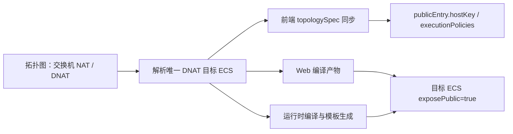

# DNAT 公网入口推导设计

## 背景

当前创建拓扑页和编译链以 ECS 节点的 `exposePublic` 或 `role === 'entry'` 判断公网入口。这与平台实际仅通过交换机 DNAT 端口映射暴露服务的能力不一致，也要求用户理解内部实现字段。

## 目标

- 公网入口唯一来源为交换机 `nat.dnatMappings[].targetHostId`。
- 用户无需再设置 `exposePublic` 或 ECS 角色来声明入口。
- 合法拓扑在编译结果中自动将 DNAT 目标 ECS 标记为 `exposePublic: true`。
- 无 DNAT、DNAT 指向多台 ECS、DNAT 目标不存在或未连接所属交换机时，给出可操作的校验结果。
- 检测失败时使用以下用户文案：

  > 请在交换机中为一台 ECS 配置至少一条 DNAT 端口映射，该 ECS 将作为公网入口。

## 入口解析规则

1. 收集所有交换机的 `nat.dnatMappings`，忽略没有有效 `targetHostId` 的映射。
2. 对目标 ECS 标识去重。
3. 仅当去重后恰有一台 ECS 时，该 ECS 为公网入口。
4. 没有有效目标时返回“缺少 DNAT 公网入口”。
5. 存在多个目标时返回“DNAT 必须全部指向同一台 ECS”的可操作错误。
6. 目标不是 ECS，或该 ECS 没有连接到配置该规则的交换机时，返回对应的结构完整性错误。

DNAT 目标和交换机连接关系均以当前拓扑图为准；不从旧的 `exposePublic` 和 `role` 字段回退推断。多网卡 ECS 只要连接到 DNAT 所在交换机即可作为目标；主网卡仍按既有规则决定主机的主网段，不因本次入口推导改变。

## 数据流

前端 `syncTopologySpecFromNodes` 和 Web 编译器使用相同的 DNAT 目标解析语义，生成的 `publicEntry.hostKey` 和 `executionPolicies` 均与该目标一致。`publicEntry.protocols` 继续使用平台既有的 SSH/HTTP 默认值。运行时编译器与场景模板生成器使用同一规则做最终防线，并在输出规格中补齐 `exposePublic: true`。

画布中的节点对象保持原样。也就是说，推导结果只作用于提交和编译出的规格，不会在用户编辑中的节点上写回 `exposePublic`、`role` 或改变节点显示。

## 错误处理

- 编辑器的早期检测首先确认至少存在一条有效 DNAT 映射；缺失时显示目标文案。
- 多个 DNAT 目标时明确提示用户将所有 DNAT 规则改指向同一台 ECS。
- 运行时保留等价的最终校验，防止绕过前端直接提交无效拓扑。
- 现有 DNAT 端口冲突、NIC/交换机连接与资源完整性校验继续生效。

## 测试

- 前端同步：合法单目标 DNAT 生成正确 `publicEntry.hostKey`、默认协议、执行策略并只在输出中标记入口主机。
- 前端同步：旧 `exposePublic`、`role: 'entry'` 不再使无 DNAT 的图通过。
- 编译：合法拓扑的入口主机为唯一 DNAT 目标，其他主机不被标记。
- 运行时：覆盖无 DNAT、多目标、目标不存在、目标未连接交换机和合法单目标 DNAT。
- 编辑器：检测错误展示新的 DNAT 引导文案。
- 不新增移动端适配测试；不执行保存、检测、发布或云资源操作。

## 范围边界

本次不改 API DTO 的历史兼容字段，不迁移已保存拓扑，不改变 DNAT 配置表单，不优化移动端，也不做任何云资源调用。`exposePublic` 保留在兼容数据模型中且 MCP 入参改为可选，但不再是入口选择依据。
